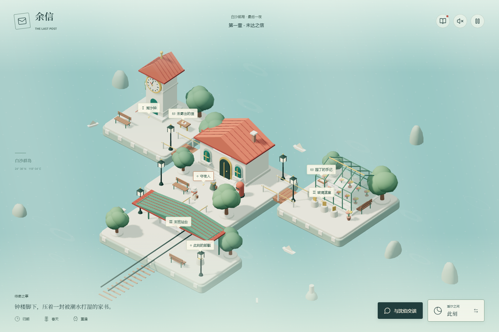

# 余信 / THE LAST POST

原创 2.5D 叙事解谜 Demo。潮水即将淹没白沙邮局，邮差许渡在“此刻”与“回声”之间投递三封迟到的信，再决定记忆的去向。



## 运行

需要 Node.js 22.12+、npm 和支持 WebGL 的现代浏览器。克隆源码后运行：

```sh
git clone https://github.com/chnoorlee/Play-Jam.git
cd Play-Jam
npm ci
npm run build
node server.mjs
```

打开终端显示的地址，默认 `http://127.0.0.1:4173`。Windows 构建后也可双击 `start.cmd`。`dist/` 为本地构建产物，不纳入 Git；不要直接双击 HTML 文件。

点击地面或地标自动行走、互动；也可使用 WASD / 方向键移动、E 互动、Q 切换时间、J 打开手记。支持触屏点按、自动存档和三个结局。运行时不调用在线大模型或外部素材服务。

## 开发与验证

```sh
npm test
npm run dev
```

开发服务器启动后，可在另一终端运行 `npx playwright install chromium` 和 `npm run test:e2e`。已保存的自动化验证记录见 [验证说明](docs/VERIFICATION.zh-CN.md)；真实设备帧率与真人体验仍待验证，建议开启浏览器硬件加速。

## 文档与许可

- [完整中文使用说明](README.zh-CN.md)
- [参赛交接说明](docs/SUBMISSION.zh-CN.md)
- [AI 工作流、案例、评审与商业化研究](docs/RESEARCH_AND_COMMERCIAL_REVIEW.zh-CN.md)
- [AI 与素材来源披露](docs/AI_AND_ASSET_DISCLOSURE.zh-CN.md)
- [含剧透通关流程](docs/WALKTHROUGH.zh-CN.md)
- [MIT 许可证](LICENSE)与[第三方许可](THIRD_PARTY_NOTICES.md)

剧情、程序化场景、声音、代码及测试由 Codex AI 辅助制作，具体范围见披露文档。当前是参赛基础 Demo；正式比赛主题尚未提供，未代为报名或提交比赛，未取得专家评审、真人试玩或商业盈利证据。
